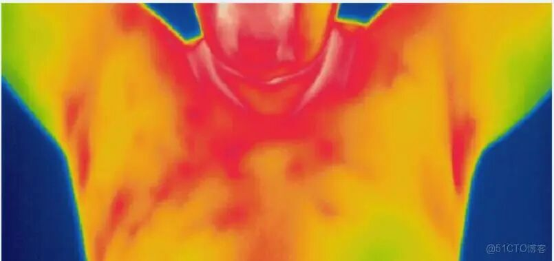
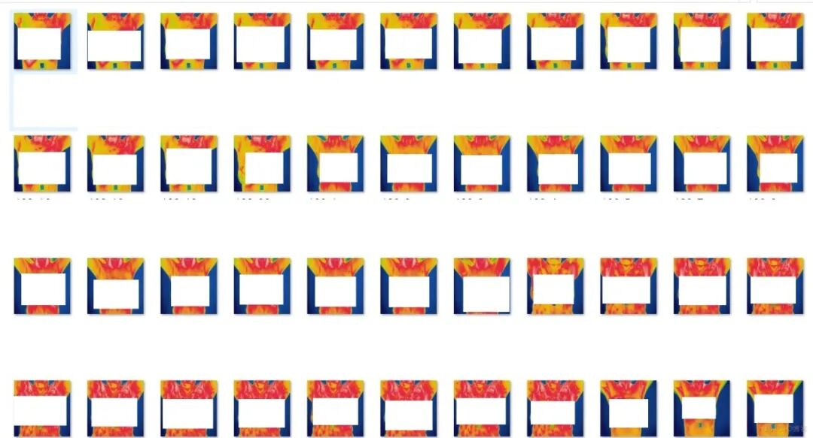

# Infrared Thermal Imaging Image Breast Cancer Classification Recognition Dataset 5283 Images 3 Categories

Dataset type: Image classification, not for object detection without annotations.

Dataset format: Only contains jpg images, each category folder contains the corresponding image.

Number of images (number of jpg files): 5283

Category: 3

Category Name: ["benign", "healthy", "malignant"]

Number of images per category:

benign(benign) 1393 images

Healthy (health) 3302 images

Malignant (malignant) 588 images

Image resolution: 640x640

Important Notice: No

Special : This dataset does not guarantee the accuracy of the trained models or weight files. The dataset is provided for accurate and reasonable classification storage only.

Image examples (possibly triggering discomfort, all images are desensitized):

## Payment

Here is a pay link on Stripe ( https://buy.stripe.com/3cs8yP7sY87d0vu9AB ). Please contact me lonlonago@foxmail.com after funding $89, and I will send you a complete data files , thank you!

